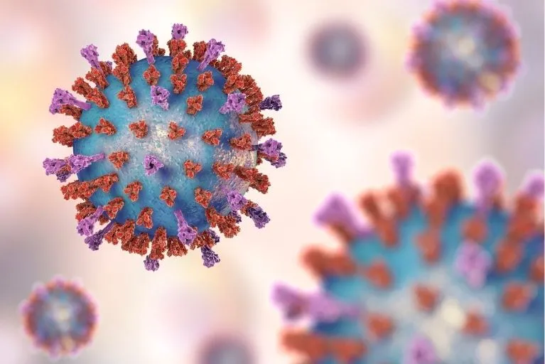
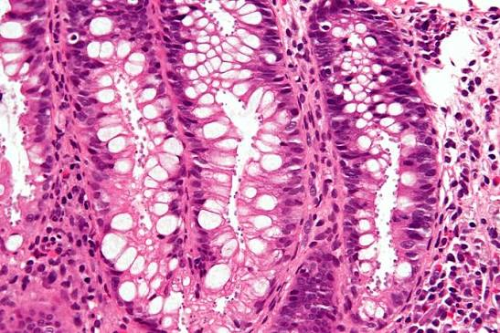
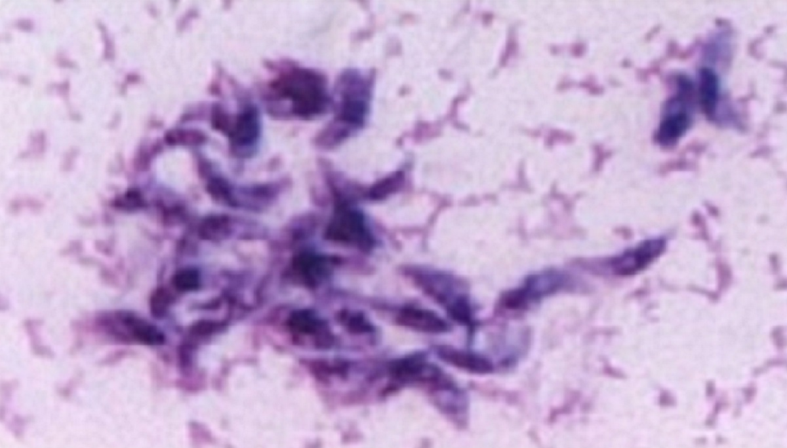

## Welcome to Become a Disease Detective ! 🔍 {#TitleSlide data-menu-title="Welcome" background-color="#881ef9" style="font-size:80px;padding: 5px "}

Organised by

R Ladies+ Melbourne

## Acknowledgement of Country {.statement}

:::{.notes}
We would like to begin by acknowledging the Wurundjeri people of the Kulin Nation, the Traditional Custodians of the land on which we gather here today. We pay our respects to their Elders past, present, and emerging, and extend that respect to all Aboriginal and Torres Strait Islander peoples. We recognize their continuing connection to land, waters, and culture, and acknowledge that they were the first scientist on this land. 
:::

## We are...

Kirsty, Dionne and Kathleen and we are from

[R Ladies+ Melbourne]{.violet}.

We are here to teach you how to code in [R]{.violet}!

## What is [coding]{.violet-emph} and what is [R]{.violet-emph} ?

. . .

[Coding]{.violet} is writing instructions that a machine or computer can understand to perform a task.

. . .

::: {style="font-size: 1.5em; fig-align: center;layout-nrow=1"}
{width="200"} {width="360"} {width="230"} {width="130"}
:::

. . .

[R]{.violet} is coding language used in statistics, data science and many other disciplines. It is also very powerful tool for visualising data.

. . .

## Why should you [learn R]{.violet}? {.center}

. . .

⚖️ R is free, open source and everyone can access

. . .

\
🥳 It can do so many things

. . .

\
📚 Lots of resources to learn and perform tasks, with a very large user community

. . .

\
🧑‍🎓 You can get a super cool job ! It's a fantastic skill that is highly sought after in the work force

## What will you learn today? {.center}

. . .

\

🗺️ What is an [infectious disease]{.violet}, what is an [outbreak]{.violet} and who are [disease detectives]{.violet}?

. . .

\
🔍 How can [R]{.violet} be used to investigate outbreaks?

. . .

\
[Then YOU! are going to join the Global Outbreak Investigation Unit and solve an outbreak!]{.violet-emph}

## What are infectious diseases?

. . .

\
🦠 Infectious diseases are caused by certain microorganisms, such as [bacteria, viruses, parasites or fungi]{.violet-emph}, and will make people (or animals) sick when they are exposed to these microorganisms.

. . .

💭 Most microorganisms don't make us sick, but some do, and these are known as [pathogens]{.violet-emph}.

. . .

🤧 There are lots of different ways that you might get an infectious disease. Some ways include breathing [respiratory droplets]{.violet}, eating [contaminated food or water]{.violet}, insect [bites]{.violet} and many many more !

:::{.notes}

Pause after reading the headline and see what students have to say

:::

## When do infectious diseases cause outbreaks?

📚The [World Health Organisation]{.violet} definition of an [outbreak]{.violet}:

. . .

💡 ["occurrence of disease in excess of normal"]{.violet.emph}

. . .

This might be because of a new pathogen, bringing pathogens to new areas, a mutating pathogen.

. . .

\
Many infectious diseases now have vaccines that mean outbreaks to these pathogens occur much less frequently (for example: measles, chicken pox, influenza etc.)

## Let's go through some examples of infectious diseases that cause outbreaks! {data-menu-title="Examples of infectious diseases!" background-color="#881ef9" style="font-size:60px;padding: 5px "}

## What is COVID-19?

::::: columns
::: {.column width="30%"}
{width="300"}
:::

::: {.column width="70%"}
-   COVID-19 is caused by a virus known as [SARS-CoV2]{.violet}. It caused a global [pandemic]{.violet}.

-   A [pandemic]{.violet} is defined as an infectious disease affecting multiple parts of the world simultaneously, i.e. multiple countries are experiencing an [epidemic]{.violet}.

-   There are now several vaccines that have helped to reduce the severity of this infection.
:::
:::::

:::{.notes}
example of a virus
:::

## What is RSV?

::::: columns
::: {.column width="30%"}
{width="300"}
:::

::: {.column width="70%"}
-   Respiratory syncytial virus [(RSV)]{.violet} infects the respiratory tract. 

-   Common symptoms can include [runny nose]{.violet}, [sneezing]{.violet}, [cough]{.violet}, [sore throat]{.violet} and [fever]{.violet}. More severe respiratory illness can occur. 

-   It spreads mainly through respiratory droplets/secretions and close contact. 

:::
:::::

::: {.notes}
Another example of a virus
Connect back to coughing/sneezing and the school contact chain. 
Avoid implying all listed severe symptoms are expected in every adolescent case.
:::

## What is cryptosporidiosis? 

::::: columns
::: {.column width="50%"}
{width="500"}
:::

::: {.column width="50%"}
-   Cryptosporidiosis is [gastroenteritis]{.violet} caused by the parasite *Cryptosporidium*.

-   Typical symptoms include [watery diarrhoea]{.violet}, [abdominal cramps]{.violet}, [nausea/vomiting]{.violet}, [fatigue]{.violet} and sometimes [fever]{.violet}.

-   Infection can occur after swallowing [contaminated recreational water]{.violet}. 

:::
:::::

::: {.notes}
Cryptosporidium is unusually resistant to normal pool chlorine levels.
Example of a parasitic infection
Victorian guidance gives an incubation range of 1–12 days, average ~7 days. 
People should avoid swimming for 2 weeks after diarrhoea stops.
:::

## What is Toxoplasmosis? 

::::: columns
::: {.column width="40%"}
{width="500"}
:::

::: {.column width="60%"}
-   Toxoplasmosis is an infection caused by the parasite [*Toxoplasma gondii*]{.violet}.

-   The parasite occurs [worldwide]{.violet} and can last for long periods of time in humans (and other animals). 

-   In fact, the parasite is [endemic]{.violet} in Melbourne: there is an ongoing transmission.

-   It spreads through contaminated soil, sand, unwashed produce, undercooked meat, or unpasteurised milk.
:::
:::::

## Who studies outbreaks

-   [Public health departments]{.violet} in the government

    -   How to improve the health of everyone

-   [Academic research]{.violet} at Research Institutes and Universities

    -   Make new discoveries, such as developing new drugs or vaccines

-   [Doctors]{.violet} and [health staff]{.violet}

    -   Keep their patients safe

. . .

And many others too !

## 

An [epidemiologist]{.violet} is someone who studies how...

. . .

\

"to keep the public informed on different public health issues and offer solutions to keep communities safe. They perform studies on outbreaks, their causes, transmission and effect on the public, collating that information into accessible data and health recommendations."

Source: [What is epidemiology and what does an epidemiologist do?](https://online.monash.edu/news/what-is-epidemiology-what-does-an-epidemiologist-do/)

:::{.notes}

Ask students if they've heard of this before 

:::

## WARNING: EMERGENCY ALERT!!! {.big-statement data-menu-title="The case" background-color="#ff5b92" style="font-size:80px;padding: 5px "}

## Incoming message: Chief Epidemiologist 

::: {.chat}
::: {.speaker-2}
Several local hospitals have reported an unusual increase in sick students from the same school. 
:::

::: {.fragment .speaker-2}
Students from two classrooms have presented with a range of symptoms. The number of cases is growing. 
:::

::: {.fragment .speaker-2}
School activities include shared classes, lunch, art, hockey and swimming practice. 
:::

::: {.fragment .speaker-2}
I need you to investigate what is causing this problem and how can we make the situation better? 
:::
:::

:::{.notes}
This is the first story reveal. Ask: What would you want to know first?
:::

## Your cohort

-   95 students are part of the investigation.

-   Some are sick. Some are well.

-   Your first task is to use the hospital records to find out how many cases there are.

:::{.notes}
Do not show 71/24 yet if you want students to calculate it in R.
Facilitator answer: 71 sick, 24 well. 
:::

## Why include students who are well? 
People who do NOT become sick are important too.

They help us ask:

- Was an exposure really associated with illness?

- Did everyone who had contact become sick?

- Are there different groups within the outbreak?

:::{.notes}
Simple epidemiology concept: comparison groups and attack-rate thinking without formal statistics.
:::

## HOSPITAL UPDATE!!! {.big-statement data-menu-title="The case" background-color="#ff5b92" style="font-size:80px;padding: 5px "}

## Incoming message: Chief Epidemiologist 

::: {.chat}
::: {.speaker-2}
Patient records have arrived from several hospitals.
:::

::: {.fragment .speaker-2}
They were assembled quickly by different staff, so some values are inconsistent.
:::

::: {.fragment .speaker-2}
I need you to load, inspect and clean the data.
:::
:::

:::{.notes}
Transition to R. Mention real outbreak data are often messy.
:::

```{=html}
<style>
.workshop-table table {
  font-size: 0.65em;
  margin-left: 0;
}
</style>
```
```{r}
#| echo: false
#| warning: false
#| error: false
#| message: false 
source(here::here("setup/setup.R"))
```

## First, open the patient file

```{r}
#| echo: true

patients_raw <- load_patients()
```

. . .

Take a look.

```{r}
#| echo: true
#| output-location: fragment

head(patients_raw)
```

:::{.notes}
Ask: what does one row represent? What information do we have about each student? Can you spot anything messy?
:::

## What information do we have?

```{r}
#| echo: true
#| output-location: fragment

names(patients_raw)
```

. . .

❓Can you find `patients_raw` in the environment pane?

## The records are messy !

The hospital entered the records very quickly.

For example:

`Yes`, `YES`, `yes` and `Y`

all mean the same thing.

. . .

Computers need us to be consistent. If `"Yes"` and `"YES"` are written differently, R thinks they are different answers.

## We can fix it with a function

Instead of fixing every value ourselves, we can use a pre-written function.

```{r}
#| echo: true

patients <- clean_data(patients_raw)
```

:::{.notes}
A function is just a saved set of instructions that someone wrote for us. Same idea as source("setup/setup.R") earlier.
:::

## How many students are sick?

```{r}
#| echo: true
#| output-location: fragment

count_cases(patients)
```

. . .

Now look at the students with the highest temperatures.

```{r}
#| echo: true
#| output-location: fragment

show_sickest(patients)
```

:::{.notes}
What do you notice about their temperatures?
:::

## What do the hospital records show? 

After cleaning:

- 95 students in the cohort

- 71 sick

- 24 well

- 51 students had a hospital visit recorded

. . .

But do all 71 sick students have the same illness?

:::{.notes}
Reveal counts after students run the relevant code. 51 is ~72% of sick students.
:::

## Incoming message: Chief Epidemiologist 

::: {.chat}
::: {.speaker-2}
We need a rapid symptom summary.
:::

::: {.fragment .speaker-2}
Investigate: the common symptoms, temperature, how quickly symptoms appeared and whether cases all look alike. 
:::
:::

:::{.notes}
Let students make/edit symptom and temperature figures.
:::

## What symptoms are most common?

```{r}
#| echo: true
#| output-location: fragment

symptoms <- symptom_table(patients)

symptoms
```

. . .

Tables are useful, but a graph is easier to read !

## How to ask ggplot to plot our symptoms

`aes` refers to the [aesthetics]{.violet} - what goes on each axis.

```{r}
#| echo: true
#| output-location: fragment

ggplot(symptoms, aes(x = n, y = symptom))
```

::: {.notes}
Say: "Next we choose what kind of graph we need."
:::

## Add the bars with `geom_col()`

We use the `+` sign to add it to our ggplot command.

```{r}
#| echo: true
#| output-location: fragment
#| code-line-numbers: "5"

ggplot(symptoms, aes(x = n, y = symptom)) +
  geom_col(fill = "purple")
```

## Give it a title and labels

```{r}
#| echo: true
#| output-location: fragment
#| code-line-numbers: "6,7,8,9,10"

ggplot(symptoms, aes(x = n, y = symptom)) +
  geom_col(fill = "purple") +
  labs(title = "Symptoms reported by sick students",
       x = "Number of students", y = "Symptom")
```

. . .

::: {.sticky color="#c8e6c9" top="200px" left="40%" width="18em" tilt="-3"}
[Your turn !]{.violet} Change `"purple"` to another colour, or change the words inside `title =`, `x =` and `y =`, and run the code again.
:::

:::{.notes}
Note the sticky is DRAGGABLE!!!!!! 
:::

## Do sick students have higher temperatures?

```{r}
#| echo: true
#| output-location: fragment
#| code-line-numbers: "3,4,6"

ggplot(patients, aes(x = case_status, y = temperature_c, fill = case_status)) +
  geom_boxplot() +
  labs(title = "Do sick students have higher temperatures?", 
       x = "Student group", y = "Temperature (°C)")
```

. . .

::: {.sticky color="#c8e6c9" top="200px" left="40%" width="18em" tilt="-3"}
[Your turn !]{.violet} Inside `aes()`, change `fill = case_status` to `colour = case_status`. What changes?
:::

:::{.notes}
Compare the middle (median) of the two boxplots.
Note the sticky is DRAGGABLE!!!!!! 
:::

## How quickly did students become sick?

```{r}
#| echo: true
#| output-location: fragment

show_onset(patients)
```

. . .

The time between being exposed and becoming sick can be an important clue.

## Two symptom patterns begin to appear
- One large group is dominated by cough, sore throat and low-grade fever.

- A smaller group is dominated by diarrhoea and vomiting.

. . . 

*Could one disease explain both patterns?*

:::{.notes}
Dataset design: among 56 RSV cases, cough 48/56 and sore throat 36/56; among 15 Crypto cases, diarrhoea 15/15 and vomiting 9/15. Keep diagnosis hidden.
:::

## Infectious diseases: different organisms, different routes

- Infectious diseases are caused by viruses, bacteria, fungi and parasites.
- Transmission routes determine outbreak patterns.

::::: columns
::: {.column width="50%"}

Respiratory transmission: 

- Spread via coughing, sneezing, talking or close contact.
- Creates infection chains through classrooms, households, and social settings.
:::

::: {.column width="50%"}
Water-associated transmission: 

- Intestinal parasites spread when infectious stages contaminate water/surfaces and are ingested.
- A shared source infects multiple people without person-to-person transmission.
:::
:::::

:::{.notes}
Use a simple virus-versus-parasite visual. Set up respiratory vs faecal-oral/environmental transmission.
Do not name RSV yet. Ask what network pattern students would expect for person-to-person spread.
Do not name Crypto yet. Ask what a contact network might look like after a common-source exposure.
:::

## NEW EVIDENCE: Where were the students? {.big-statement data-menu-title="The case" background-color="#ff5b92" style="font-size:80px;padding: 5px "}

## Incoming message: Chief Epidemiologist 

::: {.chat}
::: {.speaker-2}
The school has provided the location and activity information.
:::

::: {.fragment .speaker-2}
Students spent time in classrooms, lunch areas, art class, hockey training and swimming practice.
:::

::: {.fragment .speaker-2}
I need you to combine location data with the patient records.
:::
:::

:::{.notes}
Transition to location/attack-rate plot.
:::

## A second file has arrived 

```{r}
#| echo: true

locations <- load_locations()
```

. . .

We need information from [both files]{.violet-emph}.

```{r}
#| echo: true

investigation <- combine_evidence(
  patients,
  locations
)
```

## Which locations have the most illness?

```{r}
#| echo: true
#| output-location: fragment

locations_summary <- location_table(investigation)

locations_summary
```

. . .

The [attack rate]{.violet} tells us what fraction of students at each location became sick.

## Let's plot the attack rates

```{r}
#| echo: true
#| output-location: fragment

ggplot(locations_summary, aes(x = attack_rate, y = location)) +
  geom_col(fill = "skyblue") +
  labs(title = "Where were sick students exposed?",
       x = "Attack rate", y = "Location")
```

. . .

::: {.sticky color="#c8e6c9" top="200px" left="40%" width="18em" tilt="-3"}
[Your turn !]{.violet} Change `"skyblue"` to another colour, then try changing the title.
:::

:::{.notes}
Does one location or activity stand out? Could there be more than one explanation?
Note the sticky is DRAGGABLE!!!!!! 
:::

## What stands out? 
Look for patterns rather than one perfect clue.

Questions:

- Are respiratory cases linked through school activities?

- Is there a location shared by the gastro cases?

- Are some students at that location sick with a different symptom pattern?

:::{.notes}
This is where swimming becomes suspicious without yet announcing Crypto.
:::

## Open the disease clue sheet

```{r}
#| echo: true
#| output-location: fragment

disease_clues <- load_disease_clues()
disease_clues
```

## Open the disease clue sheet

Before we see the laboratory results, decide:

1. Which diseases fit the cough and sore throat group?
2. Which diseases fit the diarrhoea and vomiting group?
3. What evidence supports your answers?

:::{.notes}
Keep both outbreak hypotheses open. Do not confirm anything yet.
:::

## BREAKING NEWS: sequencing results{.big-statement data-menu-title="The case" background-color="#ff5b92" style="font-size:80px;padding: 5px "}

## Incoming message: Chief Epidemiologist 

::: {.chat}
::: {.speaker-2}
The reference laboratory has sequenced selected patient samples.
:::

::: {.fragment .speaker-2}
You will compare the simulated sequences with reference organisms using a tree.
:::

::: {.fragment .speaker-2}
Do all patient samples belong to the same cluster?
:::
:::

:::{.notes}
Explicitly say these are simulated teaching sequences.
:::

## How to read the tree
A phylogenetic tree groups sequences by similarity.

💡 Tips:

- tips that join closely are more similar in this teaching dataset
- look for patient samples clustering near a named reference
- branch position matters more than left-to-right order

:::{.notes}
Keep this conceptual. Avoid implying the cross-virus/parasite branch lengths are biologically meaningful.
:::

## Respiratory references in our tree
RSV - respiratory syncytial virus; a contagious respiratory virus that commonly causes cold-like illness and can cause more severe lower-respiratory disease.

HMPV - human metapneumovirus; another respiratory virus that can produce RSV-like illness.

Influenza - the virus responsible for seasonal flu.

SARS-CoV-2 - the virus that causes COVID-19.

Rhinovirus - a very common cause of the common cold.

:::{.notes}
In the synthetic tree, RSV is closest to HMPV, while influenza, SARS-CoV-2 and rhinovirus are more distant teaching references. Clarify that the alignment is artificial.
:::

## Parasite references in our tree
Cryptosporidium - a microscopic intestinal parasite that causes cryptosporidiosis, usually with watery diarrhoea and gastrointestinal symptoms; recreational water is a recognised source.

Toxoplasma gondii - a protozoan parasite that causes toxoplasmosis.

Eimeria - a group of protozoan parasites best known for intestinal disease in animals.

Plasmodium spp. - protozoan parasites that cause malaria and are transmitted by Anopheles mosquitoes.

:::{.notes}
In the synthetic tree, Crypto sits with the parasite teaching references, with Toxoplasma/Eimeria closer and Plasmodium more distant. Do not present this artificial tree as a real evolutionary analysis.
:::

## Let's draw the tree

```{r}
#| echo: true
#| output-location: fragment

show_tree(
  sample_colour = "red",
  reference_colour = "grey30",
  title = "Which reference is closest to the outbreak samples?"
)
```

. . .

::: {.sticky color="#c8e6c9" top="200px" left="40%" width="18em" tilt="-3"}
- Which reference is closest to most of the student samples?
- Do [all]{.violet-emph} of the student samples belong to the same group?
:::

:::{.notes}
A tree tells us which samples are genetically similar. It cannot prove exactly who infected whom.
:::

## The tree reveals two groups

- Patient sequences do not form one cluster.

- One set clusters with RSV.

- Another set clusters with Cryptosporidium.

- We may be investigating TWO outbreaks at the same time.

:::{.notes}
This is the major diagnostic reveal. Let students identify the labels before showing the final sentence if possible.
:::

## CONTACT TRACING UPDATE {.big-statement data-menu-title="The case" background-color="#ff5b92" style="font-size:80px;padding: 5px "}

## Incoming message: Chief Epidemiologist 

::: {.chat}
::: {.speaker-2}
Interviewers have provided contact information!!
:::
:::

. . . 

Now we ask:

- Can we see person-to-person spread?
- Who is connected to the first recognised case?
- Are all sick students connected in the same way?

:::{.notes}
Transition to network figure.
:::

## Who had contact with whom?

```{r}
#| echo: true

contacts <- load_contacts()
```

. . .

How many separate groups are in the contact data?

```{r}
#| echo: true
#| output-location: fragment

network_groups(contacts)
```

## Let's draw the network

```{r}
#| echo: true
#| output-location: fragment

show_network(contacts, patients, 
    sick_colour = "red", well_colour = "blue",
    title = "Who had contact with whom?")
```

. . .

::: {.sticky color="#c8e6c9" top="200px" left="40%" width="18em" tilt="-3"}
- Are most sick students connected?
- Why might some connected students still be well?
- Does a connection [prove]{.violet-emph} that infection occurred?
:::

:::{.notes}
Let students find the separate gastro group themselves before the next slides explain it.
:::

## The RSV network 

P01 recently returned from holiday via an international airport and is the likely introduction in our fictional scenario.

From P01, the contact pattern branches through:
classroom → classmates → lunch/art → second classroom → hockey.

Some connected students remain well.

:::{.notes}
Important: call this a plausible contact/transmission pattern, not proof that each edge identifies who infected whom
:::

## The swimming-pool cases
The gastro cases appear separately rather than forming a person-to-person chain.

Their important connection is not an edge on the contact network - it is the shared swimming-pool exposure.

Some students around the swimming group have RSV because they are connected back into the school respiratory network.

:::{.notes}
This is the key lesson: network + location + symptoms + lab evidence must be interpreted together.
:::

## FINAL BRIEF  {.big-statement data-menu-title="The case" background-color="#ff5b92" style="font-size:80px;padding: 5px "}

## FINAL BRIEF 

Your team must report:

1. One outbreak or more than one?
2. Most likely diagnosis for each group
3. Three pieces of evidence
4. Likely exposure/transmission route
5. One limitation
6. One public-health action for each outbreak

## Case solved {.big-statement data-menu-title="The case" background-color="#ff5b92" style="font-size:80px;padding: 5px "}

## Case solved

::::: columns
::: {.column width="50%"}
[OUTBREAK 1: RSV]{.accent-rose}

- 56 sick students
- Likely introduction: P01 after holiday/airport travel
- Pattern: person-to-person respiratory spread through school contacts
:::

::: {.column width="50%"}
[OUTBREAK 2: Cryptosporidiosis]{.accent-rose}

- 15 sick students
- Pattern: common swimming-pool exposure
:::
:::::

. . . 

24 students remained well.

## What would public health officers do next? 

::::: columns
::: {.column width="50%"}

[For a respiratory outbreak:]{.accent-rose}

- identify cases and advise on staying home while unwell
- reinforce cough/hand hygiene and ventilation
- monitor for additional cases
:::

::: {.column width="50%"}
[For suspected pool-associated Crypto:]{.accent-rose}

- confirm cases and investigate the aquatic facility
- advise people with diarrhoea not to swim
- work with environmental health/pool operators on control measures
:::
:::::

## Real life: RSV in Australia, 2026

<!-- INSERT IMAGE: WEBSITE IS CURRENTLY UNDER MAINTENANCE SO CAN'T TAKE SCREENSHOT -->
<!--  -->

- The workshop's RSV storyline was inspired by a July 2026 newsGP report.

- During the first half of 2026, RSV was the most notified of RSV, influenza and COVID-19 nationally: 83,678 RSV notifications, compared with 51,655 COVID-19 and 49,785 influenza notifications.

- RSV accounted for 45% of notifications across those three respiratory viruses in that period.

:::{.notes}
Source: RACGP newsGP, 15 July 2026. Clarify that our fictional school outbreak and student numbers are invented; the national notification figures are real.
RACGP newsGP - “RSV tops most notified respiratory virus”, https://www1.racgp.org.au/newsgp/clinical/rsv-tops-most-notified-respiratory-virus 
:::

## Real life: Crypto and swimming pools 


Pool-associated cryptosporidiosis is a real public-health problem.

Victorian health guidance recognises public pools and recreational water as outbreak sources, and Crypto can survive normal pool chlorine levels.

In February 2026, an Adelaide aquatic-centre cluster involved eight cases linked to Waterworld, with pools temporarily closed for decontamination.

:::{.notes}
This grounds the fictional swimming scenario in a contemporary Australian example. Also mention Victoria recorded 1,125 notifications in 2025 after a record 2,350 in 2024 if useful.
:::

## Why rapid outbreak response matters

At the beginning, the team had messy hospital records and an unexplained cluster.

By combining epidemiology, coding, laboratory evidence and contact tracing, you separated two outbreaks with different transmission routes.

That is exactly why outbreak teams use multiple sources of evidence.

:::{.notes}
Finish on the multidisciplinary message: data science + biology + epidemiology + public health.
:::

## Today we have learnt...

. . .

🦠 What are pathogens and what are outbreaks

. . .

🌎 Who are epidemiologists

. . .

🔢 What is R

. . .

📊 How to make plots with `ggplot`

. . .

📈 How to organise and arrange complex data

. . .

## 🤠 What's something that you've learnt today? {background-color="#881ef9" style="font-size:70px;padding: 5px"}

## Do you want to learn more?

[Our online slides of today's lesson](https://r-ladiesmelbourne.github.io/17-11-23-ItTakesASpark/) <!-- update with new link!  -->

. . .

[RStudio Education for Beginners](https://education.rstudio.com/learn/beginner/)

[R for Data Science](https://r4ds.had.co.nz/)

[The Epidemiologist R Handbook](https://epirhandbook.com/en/)

[R You With Me](https://rladiessydney.org/courses/ryouwithme/)

[R-Graph Gallery](https://r-graph-gallery.com/)

## And thank you to...

. . .


. . .

It Takes a Spark !

. . .

and to all of you for helping solve the outbreak !
